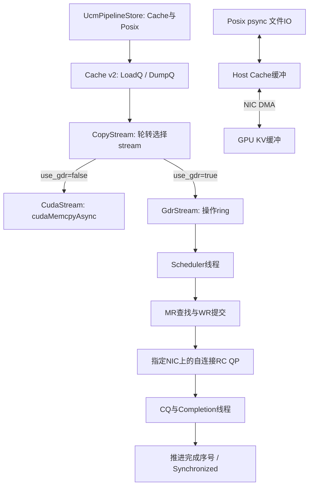

# UCM GDR 实现与小 IO 性能分析

日期：2026-11-03。分析基线：`learngdr`，主仓库提交 `8e03c9d85fba6e803fae3824b89444c703066113`，以及本分支新增的 GDR trace。

本文以源码为依据说明实现，以用户提供的数据提出性能假设；没有在目标 H100 服务器上完成性能验证。文中的“小 IO”指单次传输 payload，而不是一个模型请求的输入 token 数。

## 1. 主要判断

**小 IO 下 RDMA 比 CUDA memcpy 快，最合理的解释是：在你当前的测试方式下，RDMA 的有效提交、调度和完成开销更低；大 IO 时，持续传输带宽占主导，CUDA 路径更占优势。** 这是待实测拆解的解释，不是所有 GPU、NIC 和测试方式都成立的规律。96 KB 是当前实验的交叉点，不是 UCM 的内置阈值。

UCM 这里的 GDR，是用 NIC 的 RDMA 能力搬运本机 Host 内存与 GPU 显存之间的数据。它通过 `libibverbs` 创建连接到自身 endpoint 的 RC QP，H2D 发 RDMA WRITE，D2H 发 RDMA READ。不是跨机器 KV 协议，也不是磁盘直接写入 GPU 的 GPUDirect Storage。

最需要记住的实现限制：

- 每个 GDR stream 只绑定一个 NIC；默认映射是 `mlx5_0`，不自动选最近卡、不自动做双 NIC 分流。
- 一次有效 copy 对应一个 WR、一个 SGE、一个 signaled completion；没有自动按 96 KB 路由，没有自动合并多个 tensor。
- D2H 使用 READ，当前 QP 的 `max_rd_atomic` 和 `max_dest_rd_atomic` 都设为 **1**；发送队列深度与 READ 并行度不是一回事。
- 长请求可能增加 WR 数量而不增加 WR 大小。因此“小 IO 下 GDR 更快”不能独自解释 8k/16k 获益、32k 反而退化。

## 2. 实验背景及适用范围

用户给出的环境和现象如下，数值尚未由本文独立复测：

| 项目 | 已知信息 |
|---|---|
| 设备 | 8 张 H100 |
| 链路 | GPU 与 RDMA 路径涉及 PCIe 4.0，具体每跳宽度及代际待确认 |
| 拓扑 | 一张 GPU 有两张最近 NIC，但两张 NIC 共用上游链路 |
| 最近单 NIC | 约 20 GB/s |
| 最近双 NIC | 合计约 25 GB/s |
| 最近加远端 NIC | 合计约 37 GB/s，需确认方向、计时和统计范围 |
| 微基准交叉点 | 小于约 96 KB 时 RDMA 快；大于时 CUDA memcpy 快 |
| 模型测试 | Qwen3 32B，8k/16k 时 GDR 约提升 20%/10%，32k 约落后 10% |
| 观察指标 | TTFT、吞吐、TPOT、E2EL、ITL 等；缺少逐项原始值和分位数 |

运行配置：

```yaml
ucm_connector_name: UcmPipelineStore
ucm_connector_config:
  store_pipeline: Cache|Posix
  storage_backends: /zsj/data
  posix_capacity_gb: 10240
  posix_io_engine: psync
  posix_data_trans_concurrency: 128
  use_gdr: true
  cache_io_aggregation: false
  cache_sdma_direct: false
```

需要保留的实验元数据还包括：实际 UCM commit、CUDA/驱动版本、TP、KV dtype、block size、blocks_per_chunk、输出长度、请求并发/到达率、缓存命中 token 数、NIC 映射、NUMA 和微基准的同步方式。仅凭“8 张卡”不能认定实际 TP 一定为 8。

本文使用十进制 GB/s；96 KiB = 98304 B，96 KB = 96000 B。汇总脚本默认按 96 KiB 分类，原微基准若用十进制，需要显式指定 96000。

## 3. 先确认当前构建真正使用哪个 Cache 实现

本提交的 [Cache CMake 配置](https://github.com/ModelEngine-Group/unified-cache-management/blob/8e03c9d85fba6e803fae3824b89444c703066113/ucm/store/cache/CMakeLists.txt) 选择：

```text
RUNTIME_ENVIRONMENT == ascend-a5 → cache/cc
其他环境，包括 CUDA           → cache/v2
```

因此 H100 的分析应从 `UC::Cache2` 进入；两套 Cache 最终复用同一套 CUDA GDR 实现。此前讨论引用过 `cache/cc` 的上层行为，下面以当前 CUDA 实际编译的 v2 为准。

**更正此前的配置建议：`cache_load_backend_only` 在旧 `cache/cc` 中存在，但当前 `cache/v2/global_config.h` 没有读取它。给这份 CUDA 构建添加该字段不能据此认定已经强制回源。** 需要通过可控的数据集、进程/缓存生命周期和来源指标构建回源场景，或另行实现并验证 v2 的 bypass 功能。

## 4. 为什么小 IO 可能 RDMA 快，大 IO 反而 memcpy 快

### 4.1 固定开销与传输时间的竞争

对“同一种同步规则下，一次传输直到完成”的简化模型：

```text
T_cuda(S) = L_cuda + S / B_cuda
T_gdr(S)  = L_gdr  + S / B_gdr
```

`S` 是字节数；`L` 是该测试口径下的固定开销；`B` 是持续有效带宽。这里的 `L` 可以包含软件提交、调度、完成观察和同步，不能只理解成 API 函数入口到出口。

如果 `L_gdr < L_cuda`，但 `B_gdr < B_cuda`，就有交叉点：

```text
S* = (L_cuda - L_gdr) / (1/B_gdr - 1/B_cuda)
```

举一个仅用于量级理解的例子：假设 GDR 为 20 GB/s，CUDA 为 30 GB/s，交叉点为 98304 B，则推算固定开销差约为：

```text
ΔL = 98304 / (20×10^9) - 98304 / (30×10^9)
   = 1.6384 微秒
```

**30 GB/s 和 1.6384 微秒是示例假设及推导，不是你的机器的测量值。** 这个例子说明，微秒级固定开销差就可能形成约 96 KiB 的交叉点，无需假设 RDMA 的大块带宽更高。

CUDA 官方建议把多个小传输合并，正是因为每次传输都有额外开销；这只能支持上述分析思路，不能证明你的 CUDA 驱动实际比 RDMA 多花了多少时间。[NVIDIA CUDA Best Practices](https://docs.nvidia.com/cuda/cuda-c-best-practices-guide/index.html#data-transfer-between-host-and-device)

### 4.2 两条路径的控制面不同

在本实现中，关闭 GDR 后，`CudaStream::HostToDeviceAsync` / `DeviceToHostAsync` 调用 `cudaMemcpyAsync`，使用 non-blocking CUDA stream。开启后则进入 UCM 自己的操作队列，由后台线程执行 verbs 提交和完成处理。

| 方面 | CUDA memcpy 路径 | UCM GDR 路径 |
|---|---|---|
| 提交入口 | CUDA runtime/driver 的 stream 工作提交 | UCM ring → scheduler → ibv_post_send |
| 搬运机制 | CUDA 管理的设备传输路径，具体引擎调度由驱动实现 | NIC 发起 DMA，访问已注册的 Host/GPU 内存 |
| 完成观察 | CUDA stream 同步 | CQ completion → operation 完成序号 |
| 每个 tensor | 当前普通路径逐项调用 API | 当前逐项构造 WR |
| 主要固定成本候选 | API/driver、命令调度、同步 | ring 调度、MR 查找、WQE 提交、CQ 处理 |
| 关键资源 | CUDA 调度及传输资源、PCIe、内存 | NIC、QP/CQ、CPU 线程、PCIe、内存 |

注册复用后，RDMA 数据提交可以避免每次重新准备内存映射；但 UCM GDR 并不是“完全没有 CPU、没有线程调度、没有系统调用”的路径。它的 CQ 空闲等待会进入 `poll`，scheduler 也可能休眠。性能取决于持续流量下这些成本如何摊销。

### 4.3 不应把“少了一次 CPU memcpy”当作默认解释

如果 CUDA 基准用 pageable Host 内存，驱动可能先 staging 到 pinned 内存；这会让比较混入额外拷贝。CUDA 文档同时指出，Async API 的行为与参数和内存类型有关，不能只凭函数名判断是否异步。[CUDA API 同步语义](https://docs.nvidia.com/cuda/cuda-runtime-api/api-sync-behavior.html)

但本仓库的 `CudaBuffer::MakeHostBuffer` 使用 `cudaMallocHost`，`Buffer::RegisterHostBuffer` 使用 `cudaHostRegister`。因此在正确注册的 Host 缓冲路径中，不能默认宣称“关闭 GDR 就多一次 CPU staging”。公平比较必须使用相同的 pinned Host buffer、相同方向和相同完成条件。

同样，GPUDirect RDMA 的含义是第三方设备可直接访问 GPU 内存，并不是“本场景没有 Host 数据”：`Cache|Posix` 的 Host Cache 就是合法的源/目的缓冲。[NVIDIA GPUDirect RDMA](https://docs.nvidia.com/cuda/gpudirect-rdma/index.html)

### 4.4 微基准计时可能改变交叉点

比较 RDMA post 返回与同步 `cudaMemcpy` 返回，测到的是不同阶段，结果不能说明传输谁更快。应区分：

| 测量口径 | 测量方法 | 能回答的问题 |
|---|---|---|
| API 提交成本 | 仅计时提交调用 | CPU 发出工作有多贵 |
| 单次完成延迟 | 提交前开始，等待该 copy 真正完成后结束 | 单个小 IO 的延迟 |
| 批次持续带宽 | 连续提交 N 次，仅在批次末等待完成 | 给定并发的吞吐 |
| UCM 任务耗时 | task 提交到 task 完成 | 含排队和数据准备的效果 |
| 模型指标 | 服务请求/响应时间与 token 统计 | 用户实际体验 |

两条路径都应先热身，并把分配、注册、初始化是否计入时间明确写进报告。H2D 与 D2H 必须分别测；CUDA event 不会自动覆盖 NIC 独立执行的 RDMA 时间，跨引擎比较应使用统一的主机计时和各自真实完成条件。

## 5. UCM GDR 的完整实现链路

### 5.1 从 Pipeline 到实际搬运



图中 ring、scheduler、CQ 是控制流程；Host↔GPU 是数据流程。Posix 文件 IO 本身不会因为 `use_gdr` 而变成 GDR。

加载时，Cache v2 的 `LoadQ::TransferOneTask` 等待 shard 就绪，必要时等待前置 CUDA event，然后 `ScatterShard` 按 tensor 大小分散到 GPU KV 地址。到任务完成边界时同步各 copy stream，再释放任务持有的缓冲。

保存时，`DumpQ::DumpOneTask` 先处理前置依赖，`GatherShards` 把 GPU tensor 收集到 Host 缓冲，`CompleteD2h` 等待完成并标记 ready，之后才向 Posix 提交落盘任务。不是先把还在写的 Host buffer 交给磁盘。

源码：[LoadQ](https://github.com/ModelEngine-Group/unified-cache-management/blob/8e03c9d85fba6e803fae3824b89444c703066113/ucm/store/cache/v2/load_queue.h)、[DumpQ](https://github.com/ModelEngine-Group/unified-cache-management/blob/8e03c9d85fba6e803fae3824b89444c703066113/ucm/store/cache/v2/dump_queue.h)、[CopyStream](https://github.com/ModelEngine-Group/unified-cache-management/blob/8e03c9d85fba6e803fae3824b89444c703066113/ucm/store/cache/v2/copy_stream.h)。

### 5.2 初始化一个 GdrStream

`Device::MakeGdrStream` 仅在编译启用 `UCM_ENABLE_GDR_STREAM` 时创建对象。`Setup` 执行：

1. 取得当前 CUDA device ID。
2. 从 `DEVICE_GDR_NICS` 逗号分隔列表按该 ID 选择一个 NIC；未配置时使用 `mlx5_0`。
3. `GdrCopyLib::Open` 建立 channel，选择并打开 verbs device，创建 PD。
4. 把已知的 Host/GPU buffer 注册到当前 PD，建立 MR 范围表。
5. 创建 CQ、completion channel、用于退出唤醒的 eventfd。
6. 创建 RC QP，依次进入 INIT、RTR、RTS。
7. 启动 scheduler 和 completion 两个后台线程。

关键代码等价于：

```cpp
const auto endpoint = QueryEndpoint(qp_, ctx_);
ConnectRcQp(qp_, endpoint, isRoce_);
```

传入的是自己的 QPN/LID/GID；因此这是本机自连接的 verbs 通道，不需要另一台服务器的 QP 握手。NIC/驱动实际如何完成自连接的物理转发，不由这几行代码证明，不能把 NIC 端口线速直接当作本地 copy 吞吐。

源码：[cuda_device.cc](https://github.com/ModelEngine-Group/unified-cache-management/blob/8e03c9d85fba6e803fae3824b89444c703066113/ucm/shared/trans/cuda/cuda_device.cc)、[gdr_config.cc](https://github.com/ModelEngine-Group/unified-cache-management/blob/8e03c9d85fba6e803fae3824b89444c703066113/ucm/shared/trans/cuda/gdr/gdr_config.cc)、[gdr_copy.cc](https://github.com/ModelEngine-Group/unified-cache-management/blob/8e03c9d85fba6e803fae3824b89444c703066113/ucm/shared/trans/cuda/gdr/gdr_copy.cc)。

这里的类名 `GdrCopyLib` 不代表使用了名为 GDRCopy 的外部 CPU 映射拷贝库；本构建显式链接的是 `ibverbs`，实际传输走 `ibv_post_send`。

### 5.3 MR：把地址变成 NIC 可访问的范围

Host/GPU buffer registry 记录缓冲的基址与长度；每个 channel 的 PD 有自己的 MR 注册表。实际 copy 先做范围查找，命中后直接取 lkey/rkey。

若快速查找未命中，代码尝试从 registry 找到所属大缓冲并注册整个范围，后续复用。如果仍无法找到，则对该次传输的地址和长度调用 `ibv_reg_mr`，把 MR 保存在 inflight slot 中，完成后 `ibv_dereg_mr`。

因此有三种成本不同的状态：已注册命中、首次注册已知范围、逐次临时注册。trace 的 `fallback_*` 只标记最后一种；`fallback=false` 不保证本次完全没有发生首次注册。

GPU 页映射/固定由底层驱动栈提供，不是 UCM 把 CUDA 虚拟地址当作物理地址直接交给 PCIe。NVIDIA 文档指出重复 pin/unpin 开销可能很大，应复用注册映射；它是小 IO 快路径成立的重要条件。[GPUDirect RDMA 注册优化](https://docs.nvidia.com/cuda/gpudirect-rdma/index.html#lazy-unpinning-optimization)

源码：[gdr_mr_buffer.cc](https://github.com/ModelEngine-Group/unified-cache-management/blob/8e03c9d85fba6e803fae3824b89444c703066113/ucm/shared/trans/cuda/gdr/gdr_mr_buffer.cc)、[cuda_buffer.cc](https://github.com/ModelEngine-Group/unified-cache-management/blob/8e03c9d85fba6e803fae3824b89444c703066113/ucm/shared/trans/cuda/cuda_buffer.cc)。

### 5.4 从 copy 操作到 WR

`GdrStream::SubmitAsync` 分配 operation ID，将目标地址、源地址、size、方向写入 SPSC ring；它的返回只代表入队，不代表传输完成。

scheduler 每批取出最多 128 个操作，但随后逐个调用 `GdrMemcpyAsyncWithReqId`，没有把 128 项合成一个大 WR。每个非零 copy：

1. 校验方向、指针、长度；超过 uint32 可表达范围会返回错误，不自动切分。
2. 查找 Host/GPU MR。
3. 占用 inflight slot；满了返回 `-EAGAIN`，scheduler yield 后重试。
4. 构造一个 SGE，length 等于本次 copy 的 bytes。
5. 构造一个 WR，设置 `IBV_SEND_SIGNALED`，调用 `ibv_post_send`。

| 方向 | verbs 操作 | SGE 本地地址 | RDMA remote 地址 |
|---|---|---|---|
| H2D | `IBV_WR_RDMA_WRITE` | Host 源地址、Host lkey | GPU 目标地址、GPU rkey |
| D2H | `IBV_WR_RDMA_READ` | Host 目标地址、Host lkey | GPU 源地址、GPU rkey |

remote 是 verbs 的访问角色，不意味着 GPU 位于远程服务器。

### 5.5 完成、等待和依赖

completion 线程先请求 CQ 通知，然后循环 `ibv_poll_cq(cq_, 1, ...)`。有成功 completion 时释放对应临时 MR 和 slot，减少 inflight 计数，推进 operation 完成记录。CQ 暂时为空时通过 `poll` 等待通知或退出唤醒。

`Synchronized` 等待目标 operation ID 之前的操作都推进到完成状态。其等待循环使用 `yield`，并不是 `cudaStreamSynchronize`。

`WaitEvent` 会在 ring 中插入 Wait 操作，scheduler 执行 `cudaEventSynchronize` 后才继续提交后面的 copy。GDR 是独立于 CUDA stream 的执行路径，因此不能删除这些依赖来“优化性能”。RDMA completion 与 GPU kernel 对数据的可见性也应按完整同步协议判断，不能让正在运行的 kernel 同时读取被外部 DMA 修改的数据。[GPUDirect RDMA 内存顺序](https://docs.nvidia.com/cuda/gpudirect-rdma/index.html#synchronization-and-memory-ordering)

源码：[gdr_stream.cc](https://github.com/ModelEngine-Group/unified-cache-management/blob/8e03c9d85fba6e803fae3824b89444c703066113/ucm/shared/trans/cuda/gdr/gdr_stream.cc)、[gdr_stream.h](https://github.com/ModelEngine-Group/unified-cache-management/blob/8e03c9d85fba6e803fae3824b89444c703066113/ucm/shared/trans/cuda/gdr/gdr_stream.h)。

## 6. 实际 IO 粒度由什么决定

`ucm_connector.py` 从 KV cache layout 导出 `tensor_size_list`，交给 Cache 配置。对于此 connector，下面的 Python 表达式是列表重复，不是把每项数值乘大：

```python
tensor_size_list = kv_cache_layout.tensor_size_list * self.blocks_per_chunk
```

Cache v2 CopyStream 把 sizes 交给 `Trans::Stream` 的数组接口，接口逐项调用单地址 copy，跳过零大小或空设备地址。对正常 Host↔GPU 路径，单个有效列表元素最终成为一个 WR。

概念上：

```text
单 WR 字节数 = 某个有效 tensor fragment 的 sizes[i]
一次完整任务的 WR 数 = 实际搬运 shard 内的有效 fragment 数之和
RDMA payload 总量 = 所有已完成 WR 的 bytes 之和
```

这里的总量与配置中的 `shard_size × shard_count` 不一定完全相等，例如存在对齐 padding、已命中缓冲而跳过 copy，或只搬运部分数据时。

对常规 GQA 的紧凑单层单 K 或 V block，可用以下公式帮助估算：

```text
S_fragment ≈ block_tokens × 本 rank 实际 KV head 数 × head_dim × dtype_bytes
```

若 K/V 合在一个 fragment、存在 padding、复制 KV heads 或非紧凑 stride，上式需相应修改；也不能默认 `本 rank KV heads = 总 KV heads / TP` 在所有布局下都成立。本文不根据模型名称猜测你的具体 fragment 大小，最终以运行时 `bytes` 直方图为准。

`IBV_MTU_4096` 与 WR 大小是不同层次。一个 64 KiB WR 仍记录 65536 B，底层可能分成多个包和 PCIe 事务；trace 不测 packet size 或 PCIe TLP size。

源码：[ucm_connector.py](https://github.com/ModelEngine-Group/unified-cache-management/blob/8e03c9d85fba6e803fae3824b89444c703066113/ucm/integration/vllm/ucm_connector.py)、[trans/stream.h](https://github.com/ModelEngine-Group/unified-cache-management/blob/8e03c9d85fba6e803fae3824b89444c703066113/ucm/shared/trans/stream.h)。

## 7. 并发限制：容易误读的几个数字

| 数字或配置 | 实际含义 | 不代表什么 |
|---|---|---|
| operation ring 8192 | 待调度操作的环容量 | 8192 个正在执行的 DMA |
| scheduler batch 128 | 每次最多取出 128 个操作 | 合并成 128 倍大的 IO |
| QP 请求深度最多 4096 | 请求创建的 max_send_wr；受设备能力约束 | 4096 个 READ 可同时执行 |
| inflight 上限 | 创建 QP 返回的 max_send_wr 减一，至少为 1 | 固定为 4095 或整个 GPU 的上限 |
| max_rd_atomic = 1 | 每个 QP 的 outstanding READ/atomic 上限 | NIC 全部 QP 合计只能有一个 READ |
| cache_stream_number 默认 4 | 每个 CopyStream 持有的 stream 数 | 全进程只有 4 个 stream 或使用 4 张 NIC |
| posix_data_trans_concurrency 128 | psync 读池、写池各自的 worker 数 | GDR 的 QP 深度或 RDMA 选卡策略 |

READ outstanding 属性语义可查 [rdma-core 的 ibv_modify_qp 手册](https://github.com/linux-rdma/rdma-core/blob/master/libibverbs/man/ibv_modify_qp.3)。本实现把请求方和响应方的相关限制都设为 1，对 D2H 尤其值得检查。READ WR 可以在队列里排队，但排队与已经在途是两回事；H2D WRITE 不能套用同一个 READ 限制来解释。

Cache v2 的 LoadQ 与 DumpQ 分别创建 CopyStream。默认 4 个 stream、两边均成功初始化时，一个 worker 的 Cache 实例通常对应 4 个 load channel 加 4 个 dump channel；每个 GDR stream 又有两个后台线程，即 16 个 GDR 后台线程，此外还有 Cache 和 Posix 线程。全机总数还取决于进程/实例数，不应只根据卡数直接推断。

scheduler 空闲 yield 若干次后 sleep 100 us；completion 空闲则等待事件。这可能影响空闲后的首批延迟，不代表每个 WR 固定增加 100 us。持续饱和与间歇请求的表现应分开测。

## 8. 如何理解你的 PCIe 与双 NIC 数据

最近单卡 20 GB/s、最近双卡合计 25 GB/s，与“双卡共享上游带宽”的假设相符。此时第二张卡只能增加约 5 GB/s，而不是再加 20 GB/s。远端路径可能绕过某段共享瓶颈，但仅凭物理距离不能判断整条路径的瓶颈。

有一个必须复核的边界：如果同一张 GPU 的全部单向 payload 都必须经过**同一条 PCIe 4.0 x16 链路**，扣除编码后的单向理论值约为：

```text
16 GT/s × 16 lanes × (128/130) ÷ 8 ≈ 31.5 GB/s
```

实际 payload 吞吐还要扣除协议等开销。代际、编码和带宽关系可参考 [Intel PCIe 规格表](https://edc.intel.com/content/www/us/en/design/products/platforms/details/raptor-lake-s/13th-generation-core-processors-datasheet-volume-1-of-2/002/pci-express-support/)。这里引用的是 PCIe 参数，不是断言你的服务器采用该 Intel 处理器。

所以 37 GB/s 不符合上述全部前提同时成立的情况。应核对它是否是双向相加、多个 GPU 聚合、各自独立测试结果相加、不同完成窗口的速率相加，或者 GPU 侧实际为更高代际/存在另一条数据路径。也可能只是 NIC 一侧某段为 Gen4，而非所有字节都经过同一条 Gen4 x16。

对当前 UCM，一个 GPU 的所有 GDR stream 按同一 device ID 解析同一个 NIC。因此你测得的双 NIC 25/37 GB/s 不是当前代码已自动利用的能力。要使用双 NIC，需要新增 channel 选择/分流、各 PD 的 MR 管理及跨 channel 完成汇合。

## 9. 为什么 32k 可能退化，但现在不能归因

如果 WR 大小 S 不变、数量 N 随请求长度增加，且所有条件固定，简单串行模型 `T=N×(L+S/B)` 的快慢关系不会仅因为 N 变大而反转。**出现反转说明需要引入额外变化，而不是只重复“96 KB 分界”这个解释。**

流水化批次的近似模型更像：

```text
T_batch ≈ L_batch + max(N / 提交处理速率, 总字节 / 持续带宽)
          + 未被重叠隐藏的等待与同步
```

下面是待验证假设及对应证据，不是已确认的根因：

| 假设 | 应观察到的证据 | 可反驳它的结果 |
|---|---|---|
| WR 粒度跨越交叉点 | 32k 的 size 直方图向更大尺寸移动 | 三个长度的 size 分布一致 |
| 单 NIC 持续带宽饱和 | 无 trace 批次吞吐趋于平台；32k 时间随 bytes 近线性增加 | NIC/链路不忙，主要时间在提交前 |
| CPU 提交/CQ 处理不足 | CPU 线程竞争、调度等待增加，CQ 观察延迟增长 | CPU 充裕且调度稳定，延迟由设备端解释 |
| D2H READ 并行度限制 | 保存路径明显弱于加载；增加 QP 或受控调整 READ 深度有效 | 退化仅在纯 H2D、无后台 dump 时发生 |
| MR 复用不足 | fallback 多，或首次注册准备时间明显增长 | 稳态注册全部命中、prepare 时间稳定 |
| Cache/Posix 来源变化 | 32k 后端读量或等待显著增加、命中率降低 | 所有组都确认完全内存命中 |
| 与模型计算/通信竞争 | 单测良好、模型并发时变差；与计算/通信重叠相关 | 无计算基准也复现同幅度退化 |

GDR 使用另一套搬运机制不代表 PCIe、Host 内存带宽、GPU 内存系统及 CPU 资源完全隔离。即使小 IO 单测获益，后台保存压力增加也可能反映到 TPOT/ITL，不能只查看前台加载的 H2D。

TTFT 更接近加载、排队、prefill 的综合结果；TPOT/ITL 关注生成期间，E2EL 包含整个响应。它们与吞吐都要独立报告，不应把一个概括百分比套到每个指标。负载、生成长度不同也会改变这些指标。

## 10. 本分支 trace 能回答什么

代码在 `PostCopyWithInflightSlot` 保存 WR 元数据，在成功 CQ 完成后、释放 MR 前输出。只有 `UCM_GDR_TRACE=1` 时启用，成功完成的 WR 才进入统计。

```text
begin_ns → MR准备/slot准备 → post_ns → RDMA提交与排队 → DMA → CQ观察 → done_ns
```

| 字段/结果 | 含义 |
|---|---|
| pid/gpu/nic/channel/req | 区分 worker、设备、通道和 WR |
| dir、bytes | H2D/D2H 及实际 WR payload |
| post_ns - begin_ns | 成功提交尝试的准备时间，可能含 MR 注册 |
| done_ns - post_ns | 提交前到软件观察完成的延迟，含排队和 CQ 调度 |
| fallback_host/gpu | 是否为本次 copy 临时创建、完成时释放的 MR |
| active_GBps | payload 总量 / post→done 区间并集长度 |
| span_GBps | payload 总量 / 首次 post 到最后 done 的跨度 |

它没有记录最初的 stream 入队时刻、所有 EAGAIN 重试耗时、CUDA event 等待，也不测硬件 DMA 独占时间。多个 WR 的延迟存在重叠，不能直接累加作为带宽分母；多个 channel 的各自 GB/s 也不能直接相加当作 GPU 总带宽。

trace 直接同步输出 stderr，绕过普通日志限流和异步覆盖；它仍会占 CPU、串行化部分输出并影响 completion 速度。即使 done 时间戳取在本条输出之前，前面记录的输出开销也会影响后续 WR，因此这些带宽是**开启诊断时的软件有效带宽**。

```bash
# 目标 Linux 机器上先重新构建并安装此分支，构建启用 PLATFORM=cuda ENABLE_GDR=1。
export UCM_GDR_TRACE=1
# DEVICE_GDR_NICS 按实际 CUDA device ID 与拓扑设置，worker 必须继承环境。
# 在原服务启动命令后加 > run-32k.log 2>&1，或分别收集各 worker stderr。
python tools/gdr_trace_summary.py run-32k.log > summary-32k.json
# 若原微基准的 96 KB 指 96000 字节：
python tools/gdr_trace_summary.py run-32k.log --threshold-bytes 96000
```

服务进程建 channel 时读取开关；修改环境变量后要重新启动相关进程。正式模型 A/B 性能测量关闭 trace。出现 GDR 错误、进程异常退出、日志截断或下游日志系统丢弃记录时，不能当作完整吞吐数据。

Cache v2 已有 `cache_load_bandwidth_gbps` / `cache_dump_bandwidth_gbps` 等任务级指标，但源码以 `shardSize × shard数 / 秒 / 1e9` 计算，单位实际是 **GB/s（字节）**，并且包含任务路径耗时。它与 RDMA WR payload 口径不同。`cache_h2d_sync_ms` 只是同步调用剩余等待，不包含已经与提交重叠完成的所有时间，不能单独当作 DMA 总时长。

源码：[Cache v2 TransManager](https://github.com/ModelEngine-Group/unified-cache-management/blob/8e03c9d85fba6e803fae3824b89444c703066113/ucm/store/cache/v2/trans_manager.h)。

## 11. 建议的验证顺序与优化边界

先验证事实，再改变执行策略；每次只改变一个主要变量。

1. 确认运行 commit、CUDA 使用 Cache v2、每 GPU 实际 NIC 和链路代际。通过启动日志及 `nvidia-smi topo -m`、`lspci -tv`、对应设备的 `lspci -vv` 检查实际路径，而不是仅使用“最近”标签。
2. 短时采集三个长度的 trace，比较 H2D/D2H 的 size 分布、数量、MR fallback、prepare 和 post→poll 延迟。
3. 固定同一 pinned buffer、相同方向和同步条件，测 16/32/64/96/128/256 KiB 及 1 MiB；同时测单次完成延迟和固定总字节的批次吞吐。微基准粒度应覆盖实际 trace 的尺寸。
4. 保持 size 不变，只增加 WR 数量，检查是否能复现模型中的性能反转；这样能把“大请求”与“大 WR”分开。
5. 分开构造内存热命中和 Posix 回源，记录来源指标；然后分别改变 Posix 并发 32/64/128、Cache stream 数 1/2/4，观察 CPU 和持续带宽。
6. 最后再研究 READ outstanding 调整、WR 批量提交、选择性 signaled、按大小走 CUDA/GDR 或双 NIC。改变完成策略必须同时调整 MR 生命周期和完成序号管理。

按大小选路不能简单写成 `if size < 96KiB`：两套引擎的工作完成顺序、前置 event、Host buffer 释放时机和任务同步都要统一管理。双 NIC 的意义也取决于完整 PCIe 路径；两张共享同一瓶颈的卡未必值得增加软件复杂度。

单独使用 `store_pipeline: Posix` 是支持的 builder，但 Posix 接收 Host 地址并执行文件 IO，自身不提供 GPU staging 或本 GDR 通道。它适用于上层已经管理 Host buffer 的场景，不是当前 GPU KV 地址路径的直接替代，也不能用来验证这一实现的 GDR 效果。

## 12. 阅读源码的最短路线

| 顺序 | 文件 | 重点符号 |
|---|---|---|
| 1 | [pipeline/connector.py](https://github.com/ModelEngine-Group/unified-cache-management/blob/8e03c9d85fba6e803fae3824b89444c703066113/ucm/store/pipeline/connector.py) | `_cache_posix_pipeline_builder`、`_posix_pipeline_builder` |
| 2 | [cache/v2/global_config.h](https://github.com/ModelEngine-Group/unified-cache-management/blob/8e03c9d85fba6e803fae3824b89444c703066113/ucm/store/cache/v2/global_config.h) | `Config::From`、`EffectiveStreamNumber` |
| 3 | [cache/v2/cache_store.cc](https://github.com/ModelEngine-Group/unified-cache-management/blob/8e03c9d85fba6e803fae3824b89444c703066113/ucm/store/cache/v2/cache_store.cc) | KV 注册、buffer/transfer 初始化 |
| 4 | 上文的 LoadQ、DumpQ、CopyStream | shard 来源、scatter/gather、stream 轮转与同步 |
| 5 | [cuda_stream.cc](https://github.com/ModelEngine-Group/unified-cache-management/blob/8e03c9d85fba6e803fae3824b89444c703066113/ucm/shared/trans/cuda/cuda_stream.cc) | 关闭 GDR 后的对照路径 |
| 6 | 上文的 gdr_stream.cc/h | ring、scheduler、completion、event、完成序号 |
| 7 | 上文的 gdr_copy.cc | 自连接 QP、MR、READ/WRITE、CQ、READ 深度 |
| 8 | 上文的 gdr_config.cc、gdr_mr_buffer.cc | NIC 映射及注册复用 |

外部机制依据已在相关段落附上 NVIDIA、Intel 和 rdma-core 链接；示例公式、实验假设和用户提供的测量值均与源码事实分开标注。
